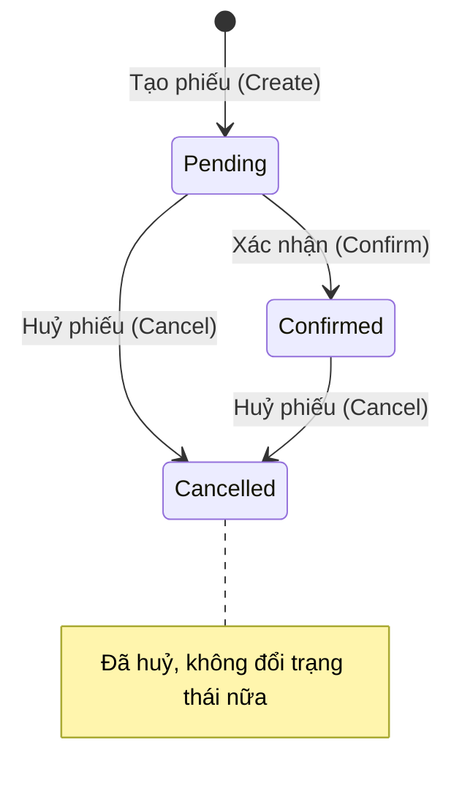

# LÝ THUYẾT - ĐỀ SỐ 02
## Câu 1a
Bốn trụ cột của lập trình hướng đối tượng:
1. Đóng gói (Encapsulation): Che giấu dữ liệu bên trong đối tượng, không cho bên ngoài can thiệp trực tiếp mà phải thông qua các phương thức công khai hợp lệ để bảo vệ tính toàn vẹn của dữ liệu.
   - Minh họa: Tệp `Member.cs`, lớp `Member` (các thuộc tính `Id`, `Email` chỉ có `get`, không có `set` công khai; việc tạo đối tượng phải qua phương thức `Create` để kiểm tra email).
2. Kế thừa (Inheritance): Cho phép lớp con kế thừa lại các thuộc tính và phương thức từ lớp cha để tái sử dụng mã nguồn và mở rộng tính năng.
   - Minh họa: Tệp `EventsController.cs`, lớp `EventsController` kế thừa từ lớp `ControllerBase`.
3. Đa hình (Polymorphism): Các đối tượng khác nhau có thể cùng phản hồi một phương thức theo những cách cài đặt riêng biệt.
   - Minh họa: Tệp `EmailNotificationService.cs` và `SmsNotificationService.cs`, hai lớp `EmailNotificationService` và `SmsNotificationService` cùng hiện thực phương thức `Send()` của interface `INotificationService`.
4. Trừu tượng hóa (Abstraction): Tập trung vào những hành vi cốt lõi cần làm mà bỏ qua các chi tiết kỹ thuật phức tạp bên dưới.
   - Minh họa: Tệp `IEventRepository.cs`, interface `IEventRepository` định nghĩa các phương thức `Add`, `GetById`, `GetByClubId`, `Delete` mà không quan tâm dữ liệu được lưu bằng bộ nhớ hay cơ sở dữ liệu.

## Câu 1b
Hai vấn đề của lớp Member chưa đóng gói:
1.Các property Id và Email đang để public set; nên chỗ khác có thể gán thẳng lung tung, ví dụ m.Email = "abc" vẫn chạy được mà không bị chặn hay kiểm tra gì.
2.Có constructor rỗng public Member() {} và không có chỗ kiểm tra dữ liệu đầu vào (như email rỗng hoặc thiếu @), nên dễ tạo ra đối tượng Member sai dữ liệu.
## Câu 2a
Sơ đồ trạng thái của Registration:



## Câu 3a
1.Single Responsibility Principle (SRP) - Nguyên lý đơn trách nhiệm (dòng 3–15):
Hàm CreateEvent làm quá nhiều việc trong một lớp: vừa kiểm tra dữ liệu đầu vào (dòng 6–7), vừa kết nối và lưu vào database (dòng 8–9), vừa ghi log ra file (dòng 10), lại vừa gửi thông báo (dòng 11–14). Sau này sửa cách ghi log hay đổi cách gửi thông báo đều phải mở file này ra sửa.
2Open/Closed Principle (OCP) - Nguyên lý đóng/mở (dòng 11–14):
Đang dùng chuỗi if (channel == "email") ... else if (channel == "sms") để chọn kênh gửi thông báo. Nếu sau này hệ thống thêm kênh mới (như Zalo hay Push Notification) thì phải sửa trực tiếp code trong hàm CreateEvent thay vì mở rộng thêm lớp mới.
3.Dependency Inversion Principle (DIP) - Nguyên lý đảo ngược phụ thuộc (dòng 8, 12, 14):
EventService tự khởi tạo trực tiếp (new) các lớp cụ thể bên trong như new SqlConnection(...), new EmailSender(), new SmsSender() chứ không thông qua interface (như repository hay notification service). Làm vậy khiến lớp bị phụ thuộc cứng vào database và các lớp gửi tin cụ thể, rất khó test hoặc thay đổi.
## Câu 4b
Phân biệt git merge và git rebase:
   git merge: Gộp nhánh bằng cách tạo thêm một merge commit (hoặc fast-forward), giữ nguyên lịch sử và nhánh rẽ thực tế. Dễ làm, an toàn, không làm đổi lịch sử cũ.
   git rebase: Dời các commit của nhánh hiện tại lên nối tiếp phần mới nhất của nhánh đích (thực chất là tạo lại commit mới), giúp lịch sử commit thẳng hàng, gọn gàng hơn nhưng làm thay đổi hash/lịch sử commit.

Khi nào không nên dùng rebase:
   Trên các nhánh chung / nhánh công khai mà nhiều người đang làm chung (như main, develop), vì viết lại lịch sử dễ làm loạn code của người khác và phải force push.
   Với các commit đã đẩy lên remote và người khác đã pull về làm tiếp.
   Khi gặp nhiều conflict phức tạp mà mình chưa nắm chắc, dùng merge sẽ an toàn và dễ theo dõi hơn.

## Câu 5a
Sơ đồ 4 lớp Clean Architecture và chiều phụ thuộc:

EduHub.API → EduHub.Application
EduHub.API → EduHub.Infrastructure
EduHub.Infrastructure → EduHub.Application
EduHub.Infrastructure → EduHub.Domain
EduHub.Application → EduHub.Domain
Phân bố cụ thể:
- EduHub.Domain: `Event`, `Member`, `Registration`, `RegistrationStatus`.
- EduHub.Application: `IEventRepository`, `EventService`, `INotificationService`, `NotificationServiceFactory`.
- EduHub.Infrastructure: `InMemoryEventRepository`, `EmailNotificationService`, `SmsNotificationService`.
- EduHub.API: `EventsController`, `Program.cs`.

## Câu 5b
Theo kiến trúc Clean Architecture thì các mũi tên phụ thuộc luôn chỉ hướng vào trong, lớp ở trong cùng không được phụ thuộc vào lớp ở bên ngoài. Domain là lớp ở trung tâm, chứa những thứ cốt lõi nhất của dự án. Còn Infrastructure là lớp bên ngoài, chỉ làm những việc cụ thể như lưu dữ liệu hay gửi mail thôi.

Nếu Domain tham chiếu đến Infrastructure thì khi mình thay đổi cái gì ở lớp ngoài như đổi cách lưu dữ liệu thì lớp trong cũng bị ảnh hưởng theo, rất dễ lỗi và khó sửa. Nên Domain phải để độc lập, chỉ các lớp ngoài gọi vào Domain thôi, Domain không được gọi ra lớp nào bên ngoài hết.
## Câu 5d
- Nguyên nhân: Với vòng đời `AddScoped`, mỗi HTTP Request sẽ tạo ra một instance mới của `InMemoryEventRepository` và hủy đi khi request kết thúc. Do đó khi gọi POST, dữ liệu được thêm vào list của instance đó rồi biến mất. Khi gọi GET ở request tiếp theo, một instance mới được tạo ra với danh sách rỗng nên trả về rỗng.
- Cách khắc phục: Em đã đăng ký dịch vụ dạng `AddSingleton` trong `Program.cs`:
```csharp
builder.Services.AddSingleton<IEventRepository, InMemoryEventRepository>();
```
Khi dùng Singleton, chỉ có một instance duy nhất tồn tại trong suốt quá trình chạy của ứng dụng, nên dữ liệu trong danh sách được giữ nguyên giữa các lần gọi API.
