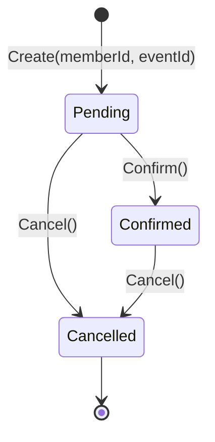
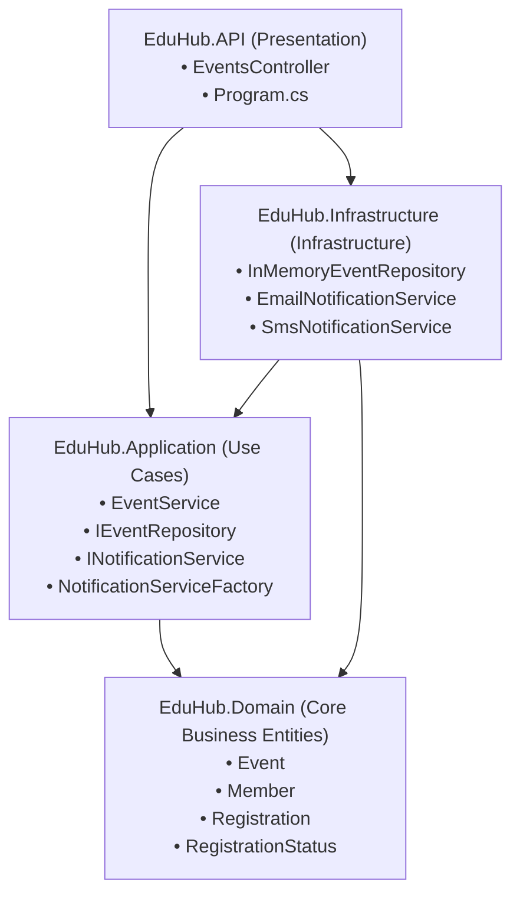

# BÀI LÀM LÝ THUYẾT - ĐỀ THI GIỮA HỌC PHẦN IN4211
**Học phần:** Phát triển phần mềm hướng đối tượng  
**Mã đề:** ĐỀ SỐ 02  

---

## Câu 1a. Bốn trụ cột của lập trình hướng đối tượng

### 1. Đóng gói (Encapsulation)
- **Giải thích:** Đóng gói là cơ chế che giấu trạng thái dữ liệu nội bộ của đối tượng và ngăn chặn sự can thiệp trực tiếp từ bên ngoài. Dữ liệu chỉ được truy cập hoặc biến đổi thông qua các phương thức công khai (public methods) có kiểm soát tính hợp lệ, đảm bảo tính toàn vẹn và bất biến của dữ liệu đối tượng.
- **Minh họa trong code bài làm:**
  - **Tên tệp:** `Member.cs` (nằm trong `EduHub.Domain/Entities/Member.cs`)
  - **Tên lớp:** `Member`
  - **Chi tiết:** Các thuộc tính `Id` và `Email` chỉ có getter `{ get; }` (không có public setter). Constructor được đặt là `private` và việc khởi tạo bắt buộc thông qua phương thức static factory `Member.Create(string email)` nhằm kiểm tra tính hợp lệ của email (không để trống và phải chứa ký tự `@`).

### 2. Kế thừa (Inheritance)
- **Giải thích:** Cho phép một lớp mới (lớp con) kế thừa lại các thuộc tính và phương thức từ một lớp đã có sẵn (lớp cha), giúp tái sử dụng mã nguồn và thể hiện mối quan hệ "is-a" (là một).
- **Minh họa trong code bài làm:**
  - **Tên tệp:** `EventsController.cs` (nằm trong `EduHub.API/Controllers/EventsController.cs`)
  - **Tên lớp:** `EventsController`
  - **Chi tiết:** Lớp `EventsController` kế thừa từ lớp cha `ControllerBase` của ASP.NET Core để tái sử dụng các phương thức và chức năng xử lý HTTP Response như `Ok()`, `BadRequest()`, `NotFound()`, `CreatedAtRoute()`.

### 3. Đa hình (Polymorphism)
- **Giải thích:** Đa hình cho phép các đối tượng khác nhau phản hồi cùng một thông điệp (gọi cùng một phương thức) theo những cách ứng xử chuyên biệt của từng đối tượng.
- **Minh họa trong code bài làm:**
  - **Tên tệp:** `EmailNotificationService.cs` và `SmsNotificationService.cs` (nằm trong `EduHub.Infrastructure/Services/`)
  - **Tên lớp:** `EmailNotificationService` và `SmsNotificationService`
  - **Chi tiết:** Cả hai lớp đều cài đặt cùng một phương thức `Send(string message)` từ giao diện chung `INotificationService`. Khi gọi `Send()`, mỗi lớp sẽ thực thi hành vi thông báo khác nhau theo kênh tương ứng (in ra console định dạng email hoặc tin nhắn SMS).

### 4. Trừu tượng hóa (Abstraction)
- **Giải thích:** Trừu tượng hóa là việc tập trung vào những hành vi cốt lõi của đối tượng, ẩn đi các chi tiết cài đặt kỹ thuật phức tạp bên dưới; phân tách rõ ràng giữa "làm cái gì" (what) và "làm như thế nào" (how).
- **Minh họa trong code bài làm:**
  - **Tên tệp:** `IEventRepository.cs` (nằm trong `EduHub.Application/Repositories/IEventRepository.cs`)
  - **Tên lớp / Interface:** `IEventRepository`
  - **Chi tiết:** Định nghĩa trừu tượng các hành vi lưu trữ sự kiện như `Add`, `GetById`, `GetByClubId`, `Delete`. Tầng Application chỉ tương tác với interface này mà không cần quan tâm dữ liệu được lưu trong bộ nhớ (`InMemoryEventRepository`) hay cơ sở dữ liệu SQL.

---

## Câu 1b. Hai vấn đề của lớp Member chưa đóng gói

Hai vấn đề nghiêm trọng trong đoạn mã ban đầu của lớp `Member`:
1. **Mất kiểm soát tính toàn vẹn dữ liệu (Public Setters):** Thuộc tính `Email` và `Id` được khai báo `public { get; set; }`. Điều này cho phép bất kỳ mã nguồn nào bên ngoài cũng có thể tự do gán giá trị không hợp lệ (ví dụ: gán email sai định dạng `m.Email = "abc"`, email rỗng, hoặc tùy tiện đổi `Id`) dẫn đến trạng thái đối tượng bị sai lệch.
2. **Khởi tạo đối tượng không hợp lệ (Public Parameterless Constructor):** Lớp cung cấp constructor mặc định rỗng `public Member() { }`, cho phép tạo ra một instance `Member` mà không cần cung cấp dữ liệu ban đầu hoặc chứa dữ liệu rác, hoàn toàn bỏ qua mọi kiểm tra nghiệp vụ bắt buộc đối với một thành viên hợp lệ.

---

## Câu 2a. Sơ đồ trạng thái của Registration (Mermaid)



---

## Câu 3a. Ba nguyên lý SOLID bị vi phạm trong EventService

Lớp `EventService` ban đầu vi phạm 3 nguyên lý SOLID sau:

1. **SRP (Single Responsibility Principle - Nguyên lý đơn trách nhiệm):**
   - **Số dòng vi phạm:** Dòng 8 - 9 (mở kết nối và ghi cơ sở dữ liệu), dòng 10 (ghi log ra tệp văn bản), dòng 11 - 14 (gửi thông báo qua email/sms).
   - **Giải thích:** Lớp `EventService` cùng lúc gánh vác quá nhiều trách nhiệm khác nhau (truy xuất DB, ghi file log, gửi thông báo). Bất kỳ thay đổi nào liên quan đến cách lưu trữ, cách ghi log hoặc hạ tầng gửi tin nhắn đều buộc phải sửa đổi lớp này.

2. **OCP (Open/Closed Principle - Nguyên lý Đóng/Mở):**
   - **Số dòng vi phạm:** Dòng 11 - 14 (`if (channel == "email") ... else if (channel == "sms") ...`).
   - **Giải thích:** Mã nguồn bị đóng với việc mở rộng. Mỗi khi hệ thống cần bổ sung một kênh thông báo mới (ví dụ: Zalo, Telegram, Webhook), lập trình viên phải sửa đổi trực tiếp vào cấu trúc `if-else` của phương thức `CreateEvent`.

3. **DIP (Dependency Inversion Principle - Nguyên lý đảo ngược phụ thuộc):**
   - **Số dòng vi phạm:** Dòng 8 (`new SqlConnection(...)`), dòng 12 (`new EmailSender()`), dòng 14 (`new SmsSender()`).
   - **Giải thích:** Module cấp cao (`EventService`) phụ thuộc trực tiếp vào các module cấp thấp và các lớp triển khai cụ thể thay vì phụ thuộc vào abstraction (interface). Điều này gây ra sự liên kết chặt chẽ (tight coupling), khó bảo trì và không thể viết unit test độc lập.

---

## Câu 4b. Phân biệt git merge và git rebase. Khi nào không nên dùng rebase?

### 1. Phân biệt `git merge` và `git rebase`
| Tiêu chí | `git merge` | `git rebase` |
| :--- | :--- | :--- |
| **Bản chất** | Tạo thêm một commit gộp (merge commit) để nối hai nhánh lại với nhau. | Lấy các commit trên nhánh hiện tại và áp dụng lại (chuyển gốc) lên đỉnh của nhánh đích. |
| **Lịch sử commit** | Giữ nguyên vẹn toàn bộ lịch sử commit và trật tự thời gian thực tế; cây lịch sử rẽ nhánh. | Lịch sử commit thẳng hàng (linear history), gọn gàng và dễ đọc. |
| **Mã băm (Hash)** | Không làm thay đổi mã hash của các commit cũ. | Tạo ra các commit mới với mã hash mới (viết lại lịch sử). |

### 2. Khi nào không nên dùng `git rebase`?
- **Quy tắc vàng (The Golden Rule of Rebase):** Tuyệt đối **không bao giờ sử dụng rebase trên các nhánh công khai (public branch)** đã được chia sẻ chung với nhóm (ví dụ: nhánh `main`, `master`, `develop` trên remote repository).
- **Lý do:** Do rebase viết lại lịch sử và thay đổi commit hash, nếu các thành viên khác đang làm việc dựa trên nhánh đó, lịch sử commit của họ sẽ bị phân kỳ (diverged history) so với remote, gây xung đột nghiêm trọng và rất khó khôi phục dữ liệu khi push.

---

## Câu 5a. Sơ đồ bốn lớp Clean Architecture và chiều phụ thuộc

### Sơ đồ quan hệ phụ thuộc:


### Vị trí các thành phần theo đúng project:
1. **EduHub.Domain:** Chứa `Event`, `Member`, `Registration`, `RegistrationStatus`.
2. **EduHub.Application:** Chứa `IEventRepository`, `EventService`, `INotificationService`, `NotificationServiceFactory`.
3. **EduHub.Infrastructure:** Chứa `InMemoryEventRepository`, `EmailNotificationService`, `SmsNotificationService`.
4. **EduHub.API:** Chứa `EventsController` và cấu hình DI trong `Program.cs`.

---

## Câu 5b. Vì sao project EduHub.Domain không được tham chiếu tới EduHub.Infrastructure?

- Theo **Quy tắc phụ thuộc (Dependency Rule)** trong Clean Architecture: Chiều phụ thuộc luôn hướng từ các tầng bên ngoài (vỏ ngoài) đi vào các tầng bên trong (lõi trung tâm).
- `EduHub.Domain` là tầng lõi trong cùng, chứa các thực thể nghiệp vụ cốt lõi (Enterprise Business Rules). Tầng này phải hoàn toàn độc lập với mọi công nghệ, cơ sở dữ liệu, framework hay thư viện bên ngoài.
- `EduHub.Infrastructure` là tầng ngoại vi chứa các công nghệ triển khai cụ thể (như SQL Server, in-memory collection, thư viện gửi email/sms bên thứ ba).
- Nếu `EduHub.Domain` tham chiếu đến `EduHub.Infrastructure`, tầng Domain sẽ bị phụ thuộc chặt chẽ vào công nghệ ngoại vi, vi phạm nguyên lý đảo ngược phụ thuộc (DIP), khiến nghiệp vụ mất tính trung lập, khó kiểm thử độc lập và khó tái sử dụng khi thay đổi nền tảng hạ tầng.

---

## Câu 5d. Giải thích lỗi AddScoped với InMemoryEventRepository và cách khắc phục

### 1. Nguyên nhân lỗi khi đăng ký AddScoped với List<Event> thông thường (không static):
- Vòng đời `Scoped` (`AddScoped`) trong ASP.NET Core quy định: một thể hiện mới của dịch vụ sẽ được tạo ra cho **mỗi HTTP Request** và bị hủy đi ngay khi HTTP Request đó kết thúc.
- Khi người dùng gửi yêu cầu `POST /api/clubs/{clubId}/events`, ASP.NET Core tạo một instance mới của `InMemoryEventRepository`. Dữ liệu sự kiện được thêm vào trường `List<Event>` của instance này. Khi phản hồi trả về cho client, request kết thúc và instance đó bị GC (Garbage Collector) thu hồi, dữ liệu vừa thêm bị xóa khỏi bộ nhớ.
- Khi người dùng gửi tiếp yêu cầu `GET /api/clubs/{clubId}/events`, đây là một HTTP Request hoàn toàn mới. ASP.NET Core lại tạo ra một instance mới toanh của `InMemoryEventRepository` với một `List<Event>` trống rỗng. Do đó, kết quả nhận được luôn là danh sách rỗng.

### 2. Cách em đã đăng ký để tránh lỗi này:
Trong tệp `EduHub.API/Program.cs`, em đăng ký `InMemoryEventRepository` với vòng đời **Singleton**:
```csharp
builder.Services.AddSingleton<IEventRepository, InMemoryEventRepository>();
```
Với `AddSingleton`, chỉ có duy nhất một instance của `InMemoryEventRepository` được tạo ra trong suốt vòng đời hoạt động của ứng dụng web. Mọi HTTP Request (cả POST, GET, DELETE...) đều dùng chung instance này, giúp dữ liệu sự kiện trong `List<Event>` được lưu giữ liên tục và nhất quán.
