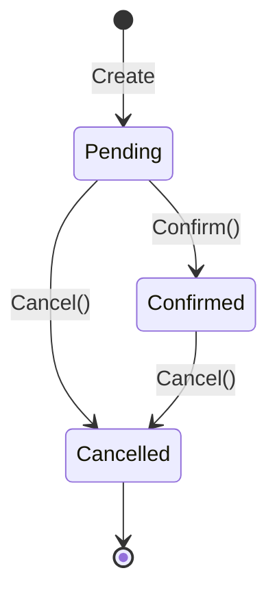
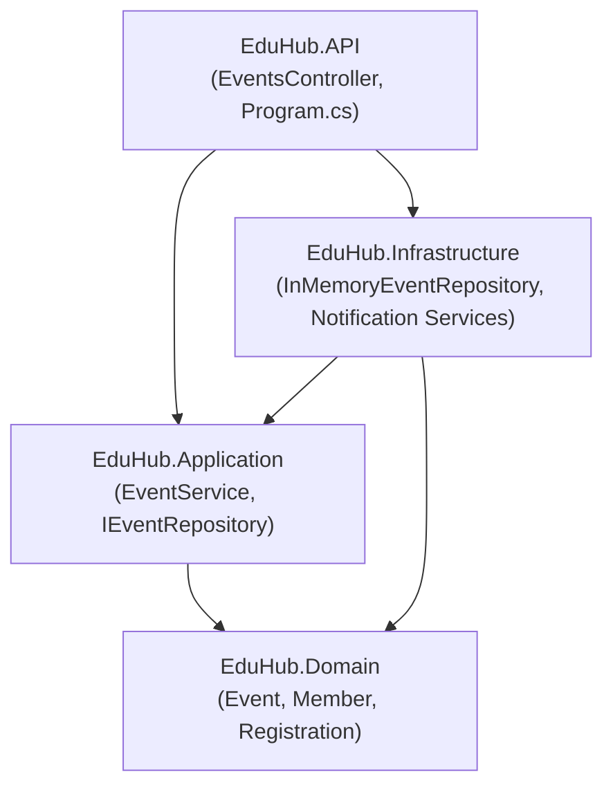

# BÀI LÀM LÝ THUYẾT - ĐỀ SỐ 02
Học phần: Phát triển phần mềm hướng đối tượng (IN4211)

## Câu 1a
Bốn trụ cột của lập trình hướng đối tượng:
1. Đóng gói (Encapsulation): Che giấu dữ liệu bên trong đối tượng, không cho bên ngoài can thiệp trực tiếp mà phải thông qua các phương thức công khai hợp lệ để bảo vệ tính toàn vẹn của dữ liệu.
   - Minh họa: Tệp `Member.cs`, lớp `Member` (các thuộc tính `Id`, `Email` chỉ có `get`, không có `set` công khai; việc tạo đối tượng phải qua phương thức `Create` để kiểm tra email).
2. Kế thừa (Inheritance): Cho phép lớp con kế thừa lại các thuộc tính và phương thức từ lớp cha để tái sử dụng mã nguồn và mở rộng tính năng.
   - Minh họa: Tệp `EventsController.cs`, lớp `EventsController` kế thừa từ lớp `ControllerBase`.
3. Đa hình (Polymorphism): Các đối tượng khác nhau có thể cùng phản hồi một phương thức theo những cách cài đặt riêng biệt.
   - Minh họa: Tệp `EmailNotificationService.cs` và `SmsNotificationService.cs`, hai lớp `EmailNotificationService` và `SmsNotificationService` cùng hiện thực phương thức `Send()` của interface `INotificationService`.
4. Trừu tượng hóa (Abstraction): Tập trung vào những hành vi cốt lõi cần làm mà bỏ qua các chi tiết kỹ thuật phức tạp bên dưới.
   - Minh họa: Tệp `IEventRepository.cs`, interface `IEventRepository` định nghĩa các phương thức `Add`, `GetById`, `GetByClubId`, `Delete` mà không quan tâm dữ liệu được lưu bằng bộ nhớ hay cơ sở dữ liệu.

## Câu 1b
Hai vấn đề của lớp Member chưa đóng gói:
1. Các thuộc tính `Id` và `Email` dùng `public { get; set; }` nên các lớp bên ngoài có thể tự do thay đổi giá trị bất kỳ lúc nào, kể cả gán dữ liệu rỗng hoặc sai định dạng email.
2. Có constructor mặc định rỗng `public Member() { }` cho phép tạo đối tượng mà không cần truyền giá trị ban đầu, không qua bước kiểm tra email hợp lệ.

## Câu 2a
Sơ đồ trạng thái của Registration:



## Câu 3a
Ba nguyên lý SOLID mà lớp EventService vi phạm:
1. Single Responsibility Principle (SRP): Dòng 8-10, phương thức vừa kết nối cơ sở dữ liệu để lưu sự kiện, vừa ghi log ra file txt, vừa gửi thông báo. Lớp có quá nhiều trách nhiệm khác nhau.
2. Open/Closed Principle (OCP): Dòng 11-14, sử dụng `if (channel == "email") ... else if (channel == "sms")`. Khi cần thêm kênh thông báo mới phải sửa trực tiếp mã nguồn của lớp.
3. Dependency Inversion Principle (DIP): Dòng 8, 12, 14, trực tiếp khởi tạo các lớp cụ thể (`SqlConnection`, `EmailSender`, `SmsSender`) thay vì phụ thuộc vào interface (abstraction).

## Câu 4b
Phân biệt git merge và git rebase:
- `git merge`: Kết hợp các nhánh bằng cách tạo ra một commit gộp (merge commit). Lịch sử được bảo toàn nguyên vẹn nhưng cây lịch sử phân nhánh nhiều.
- `git rebase`: Chuyển gốc các commit của nhánh hiện tại đặt lên đỉnh của nhánh đích. Lịch sử commit thẳng hàng và gọn gàng hơn, nhưng commit hash sẽ bị thay đổi (viết lại lịch sử).
- Khi nào không nên dùng rebase: Không dùng rebase trên các nhánh công khai (như `main` hay nhánh làm chung) vì sẽ làm sai lệch lịch sử commit của các thành viên khác khi đồng bộ code.

## Câu 5a
Sơ đồ 4 lớp Clean Architecture và chiều phụ thuộc:



Phân bố cụ thể:
- EduHub.Domain: `Event`, `Member`, `Registration`, `RegistrationStatus`.
- EduHub.Application: `IEventRepository`, `EventService`, `INotificationService`, `NotificationServiceFactory`.
- EduHub.Infrastructure: `InMemoryEventRepository`, `EmailNotificationService`, `SmsNotificationService`.
- EduHub.API: `EventsController`, `Program.cs`.

## Câu 5b
Vì theo Dependency Rule trong Clean Architecture, chiều phụ thuộc chỉ được phép hướng từ ngoài vào trong:
- `EduHub.Domain` là tầng lõi trong cùng chứa các nghiệp vụ cốt lõi, không được phụ thuộc vào bất kỳ framework hay công nghệ bên ngoài nào.
- `EduHub.Infrastructure` là tầng ngoại vi chứa các công nghệ triển khai cụ thể (database, I/O, service bên ngoài).
Nếu Domain tham chiếu tới Infrastructure sẽ làm nghiệp vụ bị phụ thuộc vào công nghệ cụ thể, vi phạm nguyên lý DIP và khó thay đổi hạ tầng hay viết unit test.

## Câu 5d
- Nguyên nhân: Với vòng đời `AddScoped`, mỗi HTTP Request sẽ tạo ra một instance mới của `InMemoryEventRepository` và hủy đi khi request kết thúc. Do đó khi gọi POST, dữ liệu được thêm vào list của instance đó rồi biến mất. Khi gọi GET ở request tiếp theo, một instance mới được tạo ra với danh sách rỗng nên trả về rỗng.
- Cách khắc phục: Em đã đăng ký dịch vụ dạng `AddSingleton` trong `Program.cs`:
```csharp
builder.Services.AddSingleton<IEventRepository, InMemoryEventRepository>();
```
Khi dùng Singleton, chỉ có một instance duy nhất tồn tại trong suốt quá trình chạy của ứng dụng, nên dữ liệu trong danh sách được giữ nguyên giữa các lần gọi API.
